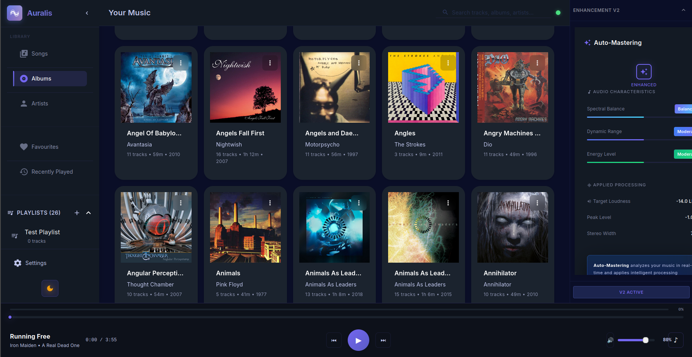

# Auralis

**A local music player that masters your music as it plays.**

Auralis plays the music files on your computer and can apply automatic mastering in real time:
it analyses each track once, works out a mastering plan for it, and renders that plan while you
listen. One switch turns it on. Your files are never uploaded, and enhancement never changes them.

[](LICENSE)
[](#download)
[-orange.svg)](docs/releases/RELEASE_NOTES_1_5_1.md)
[](FIRST_TIME_SETUP.md)
[](FIRST_TIME_SETUP.md)



---

## Status: v1.5.1 is not released yet

`master` identifies as **v1.5.1**, an unreleased recovery milestone. It has not been tagged,
and no v1.5.1 binaries exist. The version number names the workstream; it is not a claim that
the release is ready.

The [recovery audit](docs/audits/AUDIT_RECOVERY_2026-07-24.md) found release-blocking defects
in startup and in three core flows. Where that stands:

- **Fixed and covered by regression tests:** fingerprint persistence on a fresh library
  (#5530), mono enhancement (#5550, #6118), and rapid track selection (#4426).
- **Fixed:** the source launcher. `pnpm run dev` and `launch-auralis-web.py` supervise one
  backend, wait for `GET /api/ready`, and stop only what they started. The packaged Electron
  app verifies its backend's launch ID and digest.
- **Still blocking a tag:** an end-to-end run of the audit's definition of "working" against a
  fresh home directory, smoke tests of every installed artifact on its platform, and code
  signing (#4905).

The [release checklist](docs/releases/RELEASE_CHECKLIST_1_5_1.md) is the gate, and the
[release notes](docs/releases/RELEASE_NOTES_1_5_1.md) summarise what changed.

---

## What it does

- **Plays your library.** WAV, FLAC, AIFF and AU through libsndfile; MP3, M4A, AAC, OGG, WMA
  and Opus through FFmpeg. The authoritative list is `SUPPORTED_FORMATS` in
  `auralis/io/formats.py`.
- **Auto-Mastering.** Each track gets a 25-dimension acoustic fingerprint, analysed once over
  the whole track. Auralis derives one mastering plan per track from it and renders that plan
  chunk by chunk during playback, so the treatment is consistent from start to finish.
  Turning the switch on or off mid-track switches the audio from the current position.
  **Settings → Enhancement** sets the intensity.
- **Library.** Add folders by dropping them on the empty library or from
  **Settings → Library**, and optionally rescan on a schedule. Browse Songs, Albums, Artists,
  Favourites and Playlists, search as you type, and queue, shuffle and repeat.
- **Track character.** A side panel draws each track's sonic character (energy, mood, waveform)
  from its fingerprint.
- **Find Similar Tracks.** Every track's menu lists the tracks in your library that sound most
  like it.
- **Metadata editing.** Edit a track's tags from its menu. These edits *are* written to the
  file.
- **Local and private.** The backend listens on `127.0.0.1` only, and there is no account.
  Auralis uses the network only to check for updates on installed builds and when you ask it to
  download album art.

The [user guide](docs/getting-started/USER_GUIDE.md) walks through every screen and setting.

---

## Download

> **No v1.5.1 binaries exist.** The last release with downloadable binaries is
> **v1.2.0-beta.2** (December 2025), many months behind `master`. Do not publish or distribute
> a v1.5.1 build until the [release checklist](docs/releases/RELEASE_CHECKLIST_1_5_1.md) is
> green.

| Platform | Download (v1.2.0-beta.2) | Notes |
|----------|--------------------------|-------|
| Linux | [AppImage](https://github.com/matiaszanolli/Auralis/releases/tag/v1.2.0-beta.2) | `chmod +x` it and run |
| Linux | [.deb](https://github.com/matiaszanolli/Auralis/releases/tag/v1.2.0-beta.2) | `sudo dpkg -i <file>` |
| Windows | [.exe](https://github.com/matiaszanolli/Auralis/releases/tag/v1.2.0-beta.2) | Run the installer |
| macOS | [.dmg](https://github.com/matiaszanolli/Auralis/releases/tag/v1.2.0-beta.2) | Drag to Applications; first launch with right-click → Open |

### Verifying a download

Release binaries are **not code-signed** (#4905). No Windows Authenticode or Apple Developer ID
certificate is wired into the build. macOS hardened runtime and Gatekeeper assessment are off,
and `electron-updater`'s Windows publisher check (`verifyUpdateCodeSignature`) is disabled.
Until certificates exist, a download is verified only by its checksum.

Each release publishes `SHA256SUMS.txt`. CI signs it as `SHA256SUMS.txt.asc` only when the
release signing key is provisioned, and that key's fingerprint is **not published yet**. Treat a
release without a valid `SHA256SUMS.txt.asc` as unverified.

```bash
gpg --verify SHA256SUMS.txt.asc SHA256SUMS.txt   # once a key fingerprint is published
sha256sum -c SHA256SUMS.txt
```

---

## Run from source

You need Python 3.14+, Node 24+ with pnpm, a Rust toolchain, and FFmpeg. The
[setup guide](FIRST_TIME_SETUP.md) has every step. The short version:

```bash
uv venv --python-preference only-managed && source .venv/bin/activate
uv pip install -r requirements.txt && uv pip install -e '.[dev]' maturin
(cd vendor/auralis-dsp && maturin develop --uv --release)   # the Rust fingerprint engine
pnpm --dir auralis-web/frontend install --frozen-lockfile
pnpm --dir desktop install --frozen-lockfile

pnpm run dev                               # Electron, backend on :8765, Vite on :3000
python launch-auralis-web.py --dev         # or the renderer in a browser, for development
```

The Rust module is required: without it the backend never reports ready and the launcher
stops. Electron is the supported product; the browser preview is a development tool, not a
web edition. To build installers, see the [build reference](docs/development/BUILD_QUICK_REFERENCE.md).

---

## How it works

```
Electron shell ── React renderer ──REST + WebSocket── FastAPI backend (127.0.0.1:8765)
                     │                                   │
                     │  float32 PCM over WebSocket       ├── library: SQLite via repositories
                     └── Web Audio (AudioWorklet)        ├── fingerprinting: Rust 25D engine
                                                         └── mastering: HybridProcessor,
                                                             15 s chunks rendered from a
                                                             whole-track plan
```

| Layer | Where | Read |
|-------|-------|------|
| Audio engine (DSP, analysis, library, player) | `auralis/` | [DSP engine](docs/subsystems/dsp-engine.md) · [fingerprinting](docs/subsystems/fingerprinting.md) · [library](docs/subsystems/library.md) · [player](docs/subsystems/player.md) |
| Backend (REST, WebSocket streaming, chunk cache) | `auralis-web/backend/` | [backend API](docs/subsystems/backend-api.md) · [WebSocket protocol](auralis-web/backend/WEBSOCKET_API.md) |
| Renderer (React, Redux, design system) | `auralis-web/frontend/` | [frontend](docs/subsystems/frontend.md) |
| Desktop shell | `desktop/` | [architecture overview](docs/architecture/overview.md) |
| Rust fingerprint engine (PyO3) | `vendor/auralis-dsp/` | [Rust DSP status](docs/features/RUST_DSP_STATUS.md) |

Start with the [architecture overview](docs/architecture/overview.md) and the
[data-flow traces](docs/architecture/data-flow.md). The [documentation hub](docs/README.md)
lists everything else.

---

## Contributing

Read [CONTRIBUTING.md](docs/CONTRIBUTING.md) first. In short:

- Branch from `master` with a `feature/`, `fix/`, `refactor/` or `docs/` prefix, and write commit
  messages as `type: description`.
- Follow the principles in [CLAUDE.md](CLAUDE.md): improve existing code rather than duplicating
  it, keep modules under 300 lines, go through the repositories for all database access, and
  preserve the audio invariants (sample count, dtype, copy before modify).
- Run the scoped tests for what you touched, plus the type checks:

```bash
python -m pytest -q -m "not slow" tests/auralis/dsp       # scope to a domain or a file
cd auralis-web/frontend && pnpm run test:memory           # frontend (needs the 2 GB heap)
mypy auralis/ auralis-web/backend/ --ignore-missing-imports
cd auralis-web/frontend && pnpm run type-check
```

CI judges every run against checked-in failure baselines. All three (backend, nightly slow suite,
frontend) are empty, so any failure is new. The
[test execution guide](docs/development/TEST_EXECUTION_GUIDE.md) explains the gates, and
[TESTING_GUIDELINES.md](docs/development/TESTING_GUIDELINES.md) explains how to write tests that
earn their place.

---

## Roadmap

The [master roadmap](docs/MASTER_ROADMAP.md) is the source of truth. Next up:

- **v1.5.1:** finish the release gate above (installed-artifact validation, a fresh-home
  working run, signing).
- **Later:** exporting enhanced audio to a file (enhancement is real-time only today), a richer
  "find songs like this" experience on top of the similarity graph, and per-album mastering
  consistency (#3481).

---

## FAQ

**Is Auralis free?**
Yes. It is open source under AGPL-3.0 for personal, research and open-source use. Proprietary or
closed-source commercial use needs a commercial license; see
[COMMERCIAL_LICENSE.md](COMMERCIAL_LICENSE.md).

**Does it work offline?**
Yes. Playback, analysis and mastering run entirely on your computer. The network is used only for
update checks on installed builds and album-art downloads you request.

**Does it change my files?**
Enhancement never does; it is applied during playback only. Editing a track's metadata does write
the new tags to the file.

**Can I export the enhanced version?**
Not yet. It is on the [roadmap](docs/MASTER_ROADMAP.md).

**How is this different from an EQ?**
An EQ applies the curve you set. Auralis measures each track (loudness, dynamics, spectral balance,
stereo image and more) and derives a mastering plan for that specific track, covering level,
EQ correction and limiting.

**Why "Auralis"?**
"Aura" plus "audio".

---

## License

Auralis is dual-licensed:

- **Open source:** [AGPL-3.0](LICENSE). You may use, modify and distribute it. If you distribute
  a modified version, or run one as a network service, you must offer its source under the same
  license.
- **Commercial:** proprietary, embedded or closed-source commercial use needs a commercial
  license. See [COMMERCIAL_LICENSE.md](COMMERCIAL_LICENSE.md) or contact
  contacto@matiaszanolli.com.

## Acknowledgments

- **Matchering 2.0**, where Auralis's audio processing began
- **FastAPI**, **React**, **Material UI** and **Electron**
- Everyone who has filed an issue or sent a patch

## Community

- [GitHub Issues](https://github.com/matiaszanolli/Auralis/issues): bugs and feature requests
- [GitHub Discussions](https://github.com/matiaszanolli/Auralis/discussions): questions and ideas
- Maintainer: [contacto@matiaszanolli.com](mailto:contacto@matiaszanolli.com)
